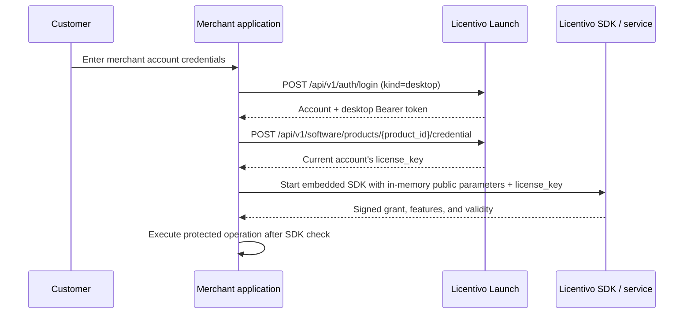

# Application integration with Launch and the Licentivo SDK

This guide is for developers integrating merchant-account purchasing and licensing into Go, Python, C#/.NET, Java, JavaScript/Node.js, Rust, Ruby, C, C++, or a trusted Web backend. **Launch** is the merchant's self-hosted account/storefront service. **SDK** is the official Licentivo runtime client.

Start with the administration **程序接入** wizard to select an existing software product and copy its automatically filled direct connection function. No manual product-ID entry or configuration files are required. A complete non-AI workflow is in [the manual nine-language guide](manual-integration.md). See the [Chinese quick start](application-quickstart.zh-CN.md), [versioned client packages](integration-packages.md), [integration OpenAPI](openapi.json), and [local/external acceptance workflow](acceptance.md).

All nine languages provide application lifecycle wrappers for login, restoration, bounded synchronization retries, protected operations, logout and explicit device release. They retain the official SDK as the runtime authority. Default sessions are memory-only; persistent secure-store availability differs by language and platform. See the package capability table and individual READMEs.

## Two complementary components

1. The **Launch account adapter** signs in to the merchant's service, verifies that the account owns the requested product, and retrieves that account's license credential.
2. The **official Licentivo SDK** handles device identity, activation, signature verification, heartbeats, offline cache, feature permissions, metering, and device deactivation.

Launch does not replace runtime license validation. Checking an order page or hiding a button is insufficient; protected operations must pass the SDK or trusted server-side entitlement check.



Using only the SDK with manual license entry is possible, but it does not provide Launch's merchant-account login, automatic post-purchase retrieval, product isolation, or refund/suspension synchronization.

## Languages without a native SDK

Launch uses ordinary HTTPS APIs, so any language with an HTTP client can authenticate and request its own credential. Runtime licensing also requires signatures, machine identity, heartbeats, offline state, clock-rollback handling, and metering.

Prefer an existing official SDK. Other native languages can bridge to the C SDK through an FFI, DLL/shared library, or a narrow in-process wrapper exposing start, feature check/run, deactivate, and close. Web applications should place SDK checks in a trusted backend. Browser JavaScript must not hold license keys or device private keys. Implement a new runtime client only against an explicitly supported upstream protocol and its compatibility test vectors.

Only public product configuration belongs in an installer. Management API keys stay on the Launch server.

## Public application configuration

| Setting | Source | Safe to distribute |
| --- | --- | --- |
| `MERCHANT_ORIGIN` | Merchant's Launch origin, e.g. `https://shop.example.com` | Yes |
| `LAUNCH_PRODUCT_ID` | The product ID in Launch administration | Yes |
| Runtime product ID and signing public keys | Read automatically from the existing mapped Licentivo product | Yes |

Public initialization arguments include the runtime product ID and signature-verification public keys. The licensing origin is fixed internally to https://www.licentivo.com. It must not contain merchant management keys, payment secrets, or customer licenses.

The Launch product ID selects the Launch credential endpoint. The mapped Licentivo product ID selects the runtime product for verification. They are distinct identifiers. Administrators map them; customers must not choose arbitrary replacements.

## Prepare the merchant backend

1. Create separate Launch products with stable IDs.
2. Create the corresponding Licentivo products/policies. Select the policy in Launch sales plans; the integration page automatically resolves its product ID and signing public keys. It never asks the integrator to type either internal ID or import public configuration files.
3. Configure one read/write management key in Launch, then select policies by name for sales plans. Launch discovers the remote product and policy version.
4. Publish plans to Launch's `sandbox` payment environment.
5. Configure Stripe or PayPal sandbox credentials and webhooks; verify payment and license synchronization.
6. Verify the customer's email if the merchant requires email verification; confirm that payment succeeded, entitlement is `active`, and the licensing job synchronized. When email is disabled or verification is optional, an unverified email does not itself block credential retrieval.

`sandbox/live` separates Launch payment records. It does not imply two Licentivo environments. Before these conditions hold, login can succeed while credential retrieval returns `ENTITLEMENT_PENDING`, `ENTITLEMENT_NOT_PURCHASED` or another actionable denial.

## Desktop integration

### 1. Sign in

```http
POST /api/v1/auth/login
Content-Type: application/json

{
  "email": "customer@example.com",
  "password": "CUSTOMER_ACCOUNT_PASSWORD",
  "kind": "desktop"
}
```

Example response shape:

```json
{
  "data": {
    "user": {
      "id": "ACCOUNT_ID",
      "email": "customer@example.com",
      "verified": true,
      "role": "customer"
    },
    "access_token": "DESKTOP_BEARER_TOKEN",
    "kind": "desktop",
    "expires_at": "EXPIRATION_TIMESTAMP"
  }
}
```

Desktop login omits the browser `Origin` header. Send the returned token through `Authorization: Bearer ...`, never as a URL parameter.

### 2. Retrieve the current account's credential

```http
POST /api/v1/software/products/{LAUNCH_PRODUCT_ID}/credential
Authorization: Bearer {access_token}
Content-Type: application/json

{
  "environment": "sandbox"
}
```

```json
{
  "data": {
    "product_id": "REQUESTED_LAUNCH_PRODUCT_ID",
    "license_key": "CREDENTIAL_FOR_THE_SDK_ONLY",
    "valid_until": "CONTRACT_DEADLINE_OR_NULL",
    "version": 1
  }
}
```

`valid_until` is a timestamp or JSON `null`; the placeholder above illustrates the field. Check that `product_id` matches the request. The endpoint requires a desktop Bearer token, reads the authenticated account, and does not accept a client-selected `user_id`.

All conditions must hold: account enabled and email verified when the merchant requires it; entitlement for this product/environment; active/unexpired/unsuspended coverage; desired local version synchronized to Licentivo; and a valid current license binding.

`GET /api/v1/software/products/{LAUNCH_PRODUCT_ID}/status?environment=sandbox` returns safe status information, the next action, account-center URL and pending retry guidance for the current desktop account. Status is not a runtime authorization grant. When pending, the credential endpoint responds with `ENTITLEMENT_PENDING` and `Retry-After: 3`; the high-level clients retry within a bounded budget.

### 3. Start the SDK and guard business operations

```text
app = connect_using_the_filled_function_from_Launch()
app.login(customer_email, customer_password)
app.run_feature("export", protected_business_action)
```

Grant access only after activation or restoration of a valid signed grant. Check each protected feature immediately before its business action, using the official feature/metering API. Do not parse a license string yourself to grant access. Do not log keys or include them in analytics/error reports.

### 4. Isolate cache state

Scope caches by:

```text
Launch origin + Launch account ID + Launch product ID + Launch payment environment
```

Packages scope the cache by those values and the mapped runtime product; the resulting private cache namespace is handled internally. Account, product, and payment-environment changes must not reuse another identity's device credentials.

### 5. Distinguish close, logout, and device release

| Action | Behavior |
| --- | --- |
| Close application | Close the SDK normally and end the process |
| Log out/switch account | Call `/auth/logout`, clear the Bearer token, close the SDK, and remove the current account/product/environment cache |
| Release this device | Explicitly call SDK deactivation, then log out if appropriate |

Do not deactivate on every ordinary close. Node-locked registrations should not churn; floating seats use the SDK's normal close/release behavior.

## Multiple products

Give each application a fixed Launch product ID, Licentivo mapping, public product configuration, cache namespace, and allowed feature set. Application A must not request product B's credential and reuse A's SDK configuration. Launch verifies account/product ownership, and the SDK separately verifies the remote product and signature context.

## Direct connection and manual development

All nine packages provide Connect/connect entry points. Select the existing software in Launch and copy the filled connection function. Add your own login UI, restore flow and protected business callback; no JSON files are needed. The [manual guide](manual-integration.md) supplies the complete language-by-language lifecycle and CMake examples. Each package README documents its exact methods and local artifact installation. AI prompts use the same generated connection function.

The full CLI harnesses in examples remain reference/testing tools; their file-oriented command lines are not prerequisites for application integration. The normal direct entry points are launchclient.Connect, Python/Node/Ruby Application.connect, C# Application.Connect, Java Launch.connect, Rust Application::connect and native C/C++ connect APIs. The package owns the default SDK factory, cache location and SDK linkage.

For a Web backend, isolate a runtime and cache per authenticated customer, serialize its lifecycle and bound its lifetime/pool. Browser applications use the host's BFF/server-side session with Secure/HttpOnly/SameSite cookies and CSRF protection. Browsers and Electron renderers do not receive Launch desktop bearer tokens, customer license keys, device credentials or management keys. See examples/web-backend for the trusted caller reference and adapt its host authentication separately.

## Error handling

| Status/code | Application behavior |
| --- | --- |
| `401 LOGIN_FAILED` | Show a generic account/password/status error without confirming account existence |
| `401 AUTH_REQUIRED` | Clear the expired/revoked desktop session and return to login |
| `403 EMAIL_VERIFICATION_REQUIRED` | Direct the customer to merchant-site verification |
| `403 ENTITLEMENT_PENDING` | Show opening/synchronizing progress; respect `Retry-After` and stop after the retry budget |
| `403 ENTITLEMENT_EXPIRED` | Open renewal/account center; do not reuse an old credential after explicit denial |
| `403 ENTITLEMENT_SUSPENDED` | Explain the suspension and offer merchant support |
| `404 ENTITLEMENT_NOT_PURCHASED` | Offer purchase or account switching; check the selected payment environment |
| `404 NOT_FOUND` | Check product configuration and resource ownership |
| `429 RATE_LIMITED` | Respect `Retry-After`; avoid a tight retry loop |
| `503 SERVICE_UNAVAILABLE` | Preserve only SDK-authorized offline behavior and report temporary unavailability |

Display stable business errors, not raw responses, keys, database errors, or upstream credentials.

Earlier clients may still encounter the legacy `ENTITLEMENT_UNAVAILABLE` code on an older server. Treat it as a denial and direct the user to the account center; do not assume it is transient and retry indefinitely.

## Session restoration and offline startup

The nine language wrappers separate application close, logout and device release. Default account-session storage is memory-only. Remembered sessions require a protected store: supported packages provide Windows current-user DPAPI or authenticated encryption with a caller-supplied key; all applications can supply the package's secure-store interface. They never persist merchant passwords. Session expiry, account/product/environment isolation and explicit online denial are enforced during restore. A temporary merchant outage may fall back only to the official SDK's cryptographically verified cached grant, subject to its offline, expiry and device rules.

The SDK's own device-credential files retain the upstream SDK format. Protect the scoped directory; DPAPI encryption of the Launch session snapshot does not imply the SDK cache is encrypted. No-offline policies and floating seats still require online startup. See the exact language APIs and platform limitations in [integration-packages.md](integration-packages.md).

## Security rules

- Use HTTPS outside loopback sandbox development.
- Do not automatically follow redirects with credentials or request bodies.
- Bound connection time, response sizes, and retries. Do not blindly replay non-idempotent actions.
- Release or overwrite mutable password buffers promptly; do not persist passwords.
- Treat desktop tokens, license keys, device private keys, and SDK cache files as sensitive.
- Ship only public product configuration, never management/payment/master keys.
- Close the current SDK before clearing its scoped cache and switching accounts.

## Release acceptance

For every released language/OS combination, verify registration and email confirmation, no-purchase denial, first activation after payment, restart recovery, offline/heartbeat/clock rules, feature/metering checks, renewal/upgrade/suspension/refund/expiry, full devices and release, logout/account switching, and isolation between products and payment environments.

The repository provides account/status APIs, client lifecycle packages, reference source and an external sandbox probe that records real observations without secrets. Complete real payment-to-application activation remains pending merchant service configuration. Real catalog reads and plan mappings do not replace first issuance with a read/write key. Follow [acceptance.md](acceptance.md), [licentivo-contract.md](licentivo-contract.md) and [progress.md](progress.md).
