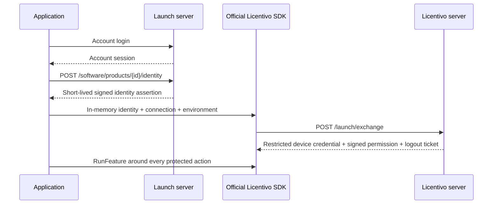

# Application integration with Launch and Licentivo

For HTTP tests on customer machines or private networks, follow [the two HTTP permissions, generated SDK options, and HTTPS migration guide in 14 languages](http-testing/README.md). A server switch does not update an installed SDK or change its configured URL.

This guide applies to the Licentivo provider. To connect a merchant-owned licensing system without Licentivo, use [the custom licensing API and integration flow](external-licensing.md), select `custom_http` for the product/environment and retain that system's runtime SDK.

These local, unpublished changes use account identity exchange. See [the responsibility and purchase-sync contract](account-purchase-boundary.md) for migration and server-side session revocation. Package version numbers have not been published or upgraded by this change.

Launch owns merchant accounts, orders, prices, renewal/upgrade quotes, refunds and absolute purchased dates. Licentivo owns licenses, policies, device allowances, authorization sessions, signed permissions and runtime decisions. A successful Launch login or synchronized purchase is never permission to execute protected work.

Use the administration integration page to obtain the direct connection call and pinned public product keys. All nine language wrappers contain the official SDK. Merchant management and payment keys stay on the server. Public product settings contain no customer credentials, device IDs, cache paths or identity assertions.

## Account exchange



The wrapper requests `POST /api/v1/software/products/{id}/identity` with `{"environment":"sandbox"}` or `live`. The returned identity assertion lasts at most 120 seconds and is bound to a registered issuer, audience, real login session, product, environment and purchase reference. It contains no feature grants, device allowance or offline policy.

The official SDK receives these values in memory:

```json
{
  "product_id": "LICENTIVO_PRODUCT_UUID",
  "trusted_keys": {"SIGNING_KEY_ID": "PINNED_PUBLIC_KEY"},
  "launch_connection_id": "LICENTIVO_LAUNCH_CONNECTION_UUID",
  "environment": "sandbox",
  "identity_token": "SHORT_LIVED_ASSERTION_FROM_LAUNCH",
  "license_key": ""
}
```

Do not write this runtime configuration to a public file or persist its assertion in an account record. Launch v2 remembered records store the account session and public routing context only. The old customer `/credential` endpoint returns HTTP 410.

## Lifecycle and storage

- `Login`: authenticate the account, request a fresh assertion, start the official SDK.
- `Restore`: confirm the remembered account online, request a fresh assertion, start the official SDK. A Launch outage does not select offline permission.
- `RunFeature`: delegate every protected execution to the official SDK. A rejected callback must never execute.
- `Close` / `Dispose` / `Drop`: stop background work, preserve intentionally remembered login and node binding.
- `Logout`: invoke the official SDK unified logout, then clear the Launch account record and end its account session.
- `ReleaseDevice`: compatibility alias for explicit logout. Report pending remote revocation honestly.

Only the official SDK removes its device credential and lease files. Never delete its cache directory or `.logout.json`: that journal holds restricted release tickets needed after failed network requests. The SDK resumes pending tickets when the matching cache is initialized again. Launch's own account storage and SDK storage have separate owners.

Applications needing offline startup use the official SDK's documented recovery flow. The SDK alone verifies signed permission, product/environment context, expiry, clock behavior and device state. Launch wrappers do not infer permission from purchased dates, a local order or the presence of a file.

Memory-only account sessions are the default. Persistent account stores must encrypt/authenticate their records and protect their keys with the operating system's credential facilities. Use a separate writable cache per merchant, account, product and environment. Browser renderers must receive business results rather than desktop account tokens, assertions or device credentials.

## Purchases and devices

Launch calculates absolute purchased dates from verified payments and immutable order coverage, then sends versioned snapshots to `/api/v1/launch/connections/{id}/events`. It polls the event until `applied`; receipt alone is not fulfillment. Renewal and refund retries cannot add the duration a second time. Refunds remove only the relevant order's coverage; a fully refunded purchase is replaced by a new reference on repurchase.

Users without access to a device can open Launch's device-management page. Lists, remaining releases, allowed actions and operation results come from Licentivo. A release carries the displayed binding generation and an unchanged operation ID. Launch does not keep a competing release counter or job executor.

## Verification and limitations

Test account exchange, ephemeral assertion storage, SDK-controlled feature execution, ordinary close, fresh-process explicit logout, pending release journals and product/environment isolation. Test the official SDK's real signed leases, offline checks and tamper rejection separately from the Launch account transport. Compilation and fixtures do not establish production acceptance.

Launch also uses Licentivo V39's `session-revocations` POST and receipt GET endpoints for desktop logout, forced session logout, password changes and account disablement. It durably freezes the original recipients and request, recovers lost responses, and confirms each environment independently. Pending account-wide notifications pause new desktop authentication; after confirmation a genuinely new login must have `auth_time` strictly after the latest `revoked_before` second. Website recovery remains available. These notifications never change purchased dates. See [the boundary and recovery contract](account-purchase-boundary.md).

See [manual integration](manual-integration.md), [AI integration](ai-integration.md), [integration packages](integration-packages.md) and [acceptance](acceptance.md).
